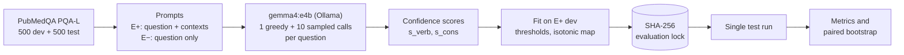

# Does a Small Language Model Know When It Lacks Medical Evidence?

A small language model running on a laptop answers biomedical research questions with *yes*, *no* or *maybe*, and says how confident it is. This project asks two things:

- **Do those confidences tell right answers from wrong ones?**
- **Can a simple threshold make the model decline when it lacks the evidence to answer, instead of guessing?**

**What was tested:**
- **Model:** `gemma4:e4b`, run locally with [Ollama](https://ollama.com).
- **Questions:** the 1,000 expert-labelled questions of [PubMedQA](https://github.com/pubmedqa/pubmedqa) (PQA-L).
- **Two conditions:**
  - **E+:** the question with the abstract's evidence paragraphs.
  - **E−:** the question alone.

The analysis was **pre-registered in code**: every threshold, the calibration map and the metric code were fitted on a development split, then frozen with SHA-256 locks, before a single test answer existed. The test split was then run exactly once. It took 22,000 local model calls at zero cost.

## Key results (500 test questions)

| | With abstract (E+) | Question only (E−) |
|---|---|---|
| Accuracy, answering every question | 0.620 | 0.156 |
| AUROC of stated confidence (s_verb) | **0.810** | 0.655 |
| AUROC of sample consistency (s_cons) | 0.593 | 0.442 |
| Calibration error (ECE), raw → recalibrated | 0.272 → **0.024** | 0.637 → 0.101 |
| Answering only when s_verb ≥ 0.85: share answered | 0.840 | 0.338 |
| … accuracy of the answers given | **0.717** | 0.254 |

**What this means:**
- **The abstract is what makes the model accurate.** Without it, accuracy falls from 0.620 to 0.156, and the model answers "maybe" to 444 of the 500 questions.
- **Stated confidence ranks answers far better than consistency across samples.** Earlier work on larger models suggested the opposite.
  - Most of the advantage comes from the answer label: "maybe" answers carry lower confidence and are usually wrong.
  - Among yes/no answers alone, both signals are only modestly above chance, and the difference between them is not significant.
- **A threshold fitted on the development split, then applied unchanged to the test split, raises accuracy** among the answers given (0.620 → 0.717 at the 70% target).
- **Isotonic recalibration fixes calibration but not ranking.**

## How it works



**Data and conditions.**
- Test is the 500 official PubMedQA test questions; dev is the other 500.
- The model never sees the abstract's conclusion (`LONG_ANSWER`).
- The prompt is [`configs/prompts/v1.txt`](configs/prompts/v1.txt).

**Calls.** Each question gets 11 calls, all with reasoning disabled, a 64-token cap and a JSON schema for the answer and confidence:
- one greedy call: temperature 0, fixed seed;
- ten sampled calls: temperature 0.7, each with its own seed.

**Confidence signals** for the greedy answer:

| Signal | Definition |
|---|---|
| `s_verb` | the model's stated confidence ÷ 100 |
| `s_cons` | share of the 10 samples that agree with the greedy answer |
| `s_iso` | isotonic recalibration of `s_verb`, fitted on E+ dev |
| `s_tok` (exploratory) | probability of the answer-label token, renormalised over yes/no/maybe |

**Abstention policy.**
- The model answers when the signal is at least a threshold t, and declines otherwise.
- t is fitted on E+ dev so that 50%, 70% or 90% of dev questions are answered, with tied scores kept together.
- The same t is then applied to both test conditions.

**Metrics.**
- AUROC.
- ECE (10 bins) and Brier score.
- Area under the risk–coverage curve.
- Coverage, accuracy of the answers given, and the confident-error rate (answered and wrong).
- Paired percentile bootstrap: 10,000 resamples, fixed seed.

## Repository layout

```
configs/             run settings (run.yaml) and the prompt template
data/manifest.json   pinned dataset revision, SHA-256 checksums, dev/test split
freeze/              the two SHA-256 locks, frozen thresholds and isotonic map
src/pubmedqa_abst/   the pipeline (below)
tests/               167 unit and integration tests
validation/          an independent re-implementation of every reported number
```

| Module | Role |
|---|---|
| `data.py` | load PubMedQA, verify checksums, build the E+ / E− prompts |
| `client.py` | Ollama client with model-digest preflight and retries |
| `parse.py` | strict JSON answer parser |
| `runner.py` | resumable, append-only runner (`runs/<run_id>/raw.jsonl`) |
| `scores.py` | per-question `s_verb` and `s_cons` |
| `thresholds.py`, `recalibrate.py` | tie-aware coverage thresholds; isotonic map saved as JSON |
| `metrics.py` | AUROC, ECE, Brier, risk–coverage, AURC, per-class tables |
| `bootstrap.py`, `stats.py` | paired bootstrap and the planned comparisons |
| `freeze.py` | write and verify the SHA-256 locks |
| `evaluate.py`, `error_analysis.py` | the locked evaluation and confident-error analysis |
| `cli.py`, `figures.py` | command-line entry point and figures |
| `posthoc.py`, `tokenprob.py` | exploratory analyses and the token-probability baseline, added after the test run |
| `report_numbers.py` | writes every reported number as a LaTeX macro, so none is typed by hand |

## Setup

**Requirements:** Python 3.12+ and [Ollama](https://ollama.com) (0.20.2 was used). The runs were made on an Apple M3 Pro with 18 GiB of memory.

```bash
python3.12 -m venv .venv && .venv/bin/pip install -e ".[dev]"
```

**Data.** The dataset is not redistributed here. Download the three files at the pinned revision; the loader checks each one against the SHA-256 checksums in `data/manifest.json`.

```bash
REV=1cbae8e92f72f20c8d3747cbb3bf5bc53554d997
mkdir -p data/raw && for f in data/ori_pqal.json data/test_ground_truth.json LICENSE; do curl -fsSL "https://raw.githubusercontent.com/pubmedqa/pubmedqa/$REV/$f" -o "data/raw/$(basename "$f")"; done
```

**Model.** The runs used digest `c6eb396dbd59`; the client's preflight refuses any other digest.

```bash
ollama pull gemma4:e4b
```

## Running it

**Replicate from scratch.** This makes 22,000 model calls (about 4.5 hours on the machine above).
- The committed `freeze/` files are write-once, so a replication writes to its own folders.
- Every run is resumable: rerun the same command after an interruption.
- A test run refuses to start until both locks exist.

```bash
D="--freeze-dir replication/freeze --runs-dir replication/runs --results-dir replication/results"
python -m pubmedqa_abst.cli $D smoke                              # 2-question check
python -m pubmedqa_abst.cli $D pilot --n 20                       # timing and parse health
python -m pubmedqa_abst.cli $D lock-protocol                      # lock prompt, config and model code
python -m pubmedqa_abst.cli $D run --split dev --condition E+
python -m pubmedqa_abst.cli $D run --split dev --condition E-
python -m pubmedqa_abst.cli $D fit                                # thresholds and isotonic map, dev only
python -m pubmedqa_abst.cli $D lock-evaluation                    # lock fits and metric code
python -m pubmedqa_abst.cli $D run --split test --condition E+
python -m pubmedqa_abst.cli $D run --split test --condition E-
python -m pubmedqa_abst.cli $D evaluate && python -m pubmedqa_abst.cli $D figures
```

**Re-evaluate the original runs.** The original model outputs (`runs/`, about 9 MB of answers and item IDs) are not in the repository and are available from the author.
- With them in place, the locked evaluation is deterministic.
- It refuses to run if any locked file has changed.

```bash
python -m pubmedqa_abst.cli evaluate        # results/metrics.json, bootstrap.json, CSVs
python -m pubmedqa_abst.cli figures         # results/figs/
python -m pubmedqa_abst.tokenprob dev test  # exploratory: 2,000 extra calls with log-probabilities (skips any already done)
python -m pubmedqa_abst.posthoc             # exploratory analyses -> results/posthoc.json
python -m pubmedqa_abst.report_numbers      # LaTeX macros and tables for the write-up
```

## Pre-registration

Two locks in `freeze/` record SHA-256 hashes and are committed with timestamps (UTC, Nov 21, 2026):

| Lock | Time | Covers | When it happened |
|---|---|---|---|
| `protocol.lock.json` | 16:33:26 | the prompt, the run config, and the data, client, parser and runner code | before any dev call |
| `evaluation.lock.json` | 18:51:17 | the thresholds, the isotonic map, the protocol lock, and the scoring, metric and bootstrap code | after both dev runs finished, 10 seconds before the first test call |

To check that nothing locked has changed (it prints nothing on success):

```bash
.venv/bin/python -c "from pathlib import Path; from pubmedqa_abst.freeze import verify_locks; verify_locks(Path('.'), Path('freeze'))"
```

`posthoc.py` and `tokenprob.py` were written after the test run and are outside the locks; their results are exploratory.

## Tests and validation

```bash
.venv/bin/pytest --cov=src/pubmedqa_abst --cov-report=term-missing
```

Some tests read the dataset, so put `data/raw/` in place first.

**`validation/`** recomputes every reported number from the raw run files without importing the pipeline. It uses its own implementations of each metric, the same bootstrap draws and the frozen thresholds, and compares each value with the generated macros.
- It needs `data/raw/`, `runs/`, and one completed pipeline run (`evaluate`, `posthoc`, `report_numbers`).
- `trace_item.py` follows a single question from its prompt to its accept-or-decline decision.

```bash
.venv/bin/python validation/run_all.py
```

```bash
.venv/bin/python validation/trace_item.py 11411430 E+
```

## Data and licence

- PubMedQA is © 2019 pubmedqa, MIT licence. Cite Jin et al., *PubMedQA: A Dataset for Biomedical Research Question Answering*, EMNLP-IJCNLP 2019.
- The dataset files are downloaded at setup and never committed.
